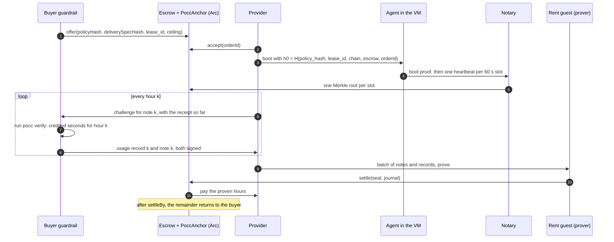

# Use case: compute rent with a delivery proof

Status: 2026-10-29, proposal. Companion to
[`hardware-purchase/spec.md`](../hardware-purchase/spec.md). It answers open point 1
of that specification for hosted services: who confirms delivery.

Abbreviations: PoCC — Proof of Cloud Compute; VM — virtual machine; TEE — trusted
execution environment; zkVM — zero-knowledge virtual machine.

## 1. The case in one paragraph

A buyer's agent rents a VM by the hour from a cloud provider. The buyer's funds sit in
the escrow from the moment the order is placed. The provider is paid only for hours
that it proved it delivered. The proof does not come from the provider's meter. It
comes from an agent inside the VM, a public randomness beacon, and anchors on the
escrow chain. A policy that the buyer approved in advance names the proof and the
price. No human touches a normal hour. The buyer's rule decides what an hour with
downtime is worth.

## 2. Why a delivery proof

The hardware-purchase specification left the question open: for a hosted service,
who signs the acceptance? A note that the buyer signs authorizes a payment. It does not
prove that the service ran. The provider's own meter is the party being paid. In the
PoCC live test of 2026-10-28, the provider's meter (OpenStack Nova) counted 3,516 s
for an hour in which PoCC credited 2,460 s. The difference was build time before the
agent was ready, ten minutes in which the provider had paused the VM, and six minutes
of heartbeats sent late after the pause, which earned nothing.

PoCC closes the gap. Its verifier credits only the seconds between two heartbeats
that the VM's agent signed and that a notary anchored within 30 s of their beacon
round. The verifier is public code over public inputs. Anyone who runs it on the same
receipt gets the same result. That makes the meter a computation, not a party.

## 3. Actors and what they hold

| Actor | Holds | Trust |
|---|---|---|
| Buyer's owner | Approves the policy once; funds orders | Trusted for their own money |
| Buyer guardrail | The wallet key and one guardrail key. The guardrail key signs notes and usage records and vouches for the provider | Trusted within the order's ceiling. It runs the PoCC verifier. |
| Provider | The payout key; the OpenStack cloud; the notary | Untrusted counterparty. Its evidence is signed by the agent in the VM, not by the provider. |
| Agent in the VM | A key born at boot and erased at the end | Trusted to sign what it sees. Without hardware attestation the provider can read the key; the policy states the assurance level it accepts. |
| Notary | An anchoring wallet | Nothing. It batches heartbeats and anchors roots. A dropped heartbeat earns nothing, so it cannot help the provider. |
| drand beacon | — | A public random value every 3 s. Fixes the earliest time of each heartbeat. |
| Escrow chain (Arc) | The USDC; the `PoccAnchor` contract | Fixes the latest time of each heartbeat; pays only on a proof |
| Rent guest (zkVM) | The checker program | Checks the usage records and the policy; emits the journal |

## 4. The policy

The buyer's policy is a rent policy of the framework
(`policy-execution/docs/framework.md`). Its `delivery` section is the delivery proof,
written in advance:

| Field | What it fixes |
|---|---|
| `kind: signed_usage`, `meter_key` | Only a usage record signed by the buyer's guardrail key counts as delivery |
| `meter_spec` | The hash of PoCC's parameters: VM image, flavor, beacon, slot length, bracket, anchor contract, attestation level. The verifier signs nothing for other parameters |
| `price_per_unit`, `tolerance` | A note for hour k pays at most `credited seconds × price` |
| `min_uptime_bp`, `min_assurance` | An hour below the uptime floor or the assurance level is not paid |
| `rule` | The owner's spending rules on top: amount cap, provider category, acceptance |

The policy also fixes `lease_id`, the ceiling, the per-hour cap and the batch size.
The escrow stores `policyHash` and `deliverySpecHash` at `offer`. A receipt for other
values cannot settle the order.

## 5. The hourly cycle

The buyer takes no part in settlement. It answers one challenge per hour, after the
hour, the last one after delivery. The provider serves hour k+1 against note k; if
note k has not arrived by the end of hour k+1, the provider stops. Its exposure to
the buyer is one hour plus provisioning. An hour below the policy's uptime floor
gets a record and a note for 0, so the batch stays contiguous and settles. If the
provider delivers nothing, no heartbeat exists and no hour is paid. The state
machine is in `lease-evidence.md` section 5a.5 of policy-execution.

## 6. What is proved and what is not

| Proved | Not proved in the first implementation |
|---|---|
| An agent key signed a heartbeat on every credited 60 s slot, and each heartbeat was anchored in time: sampled liveness. Stage 0 assumes the provider does not extract the key and run the signer elsewhere | That the machine was available between two heartbeats, that it ran the agreed image on genuine hardware (Stage 1, AMD SEV-SNP), that it had the agreed resources, that it was fast, or that any job ran correctly. PoCC's architecture lists which evidence establishes each |
| The seconds were counted by public code that anyone can re-run | That the buyer's guardrail ran that code: the guest checks the guardrail's signature and the gates, not the metering. The first implementation trusts the guardrail's attestation of delivery |
| The provider was paid at most `credited × price` per hour, to the fixed recipient, inside the ceiling | That the records are true. A buyer that under-credits loses its service after one hour and can be shown wrong by anyone who re-runs the verifier. A buyer that over-credits pays from its own funds. Whoever holds the buyer's guardrail key can sign records and notes that agree and pay the recipient for hours that did not happen, up to the ceiling |
| Every payment names the policy and the delivery specification the buyer approved | — |

A later step runs the PoCC verifier inside the rent guest over authenticated
evidence. The chain then re-runs the meter, and the guardrail key no longer attests
delivery.

## 7. Disputes

Not in the first implementation. A disagreement ends where the framework ends it:
a missing or insufficient record gives `Ask`, the owner decides, and the hour stays
unpaid until then. A dispute entity with re-execution by a referee is designed in the
PoCC integration specification and deferred.

## 8. Costs

| Item | Size |
|---|---|
| Agent in each VM | One signature and one small request per minute |
| Notary anchoring | 1,440 transactions a day for all VMs together; paid by the provider as a cost of selling |
| Verification | Seconds of CPU per hour, on the buyer's side |
| Proving | One proof per batch of hours, in the background; the batch size follows the measured proving cost |

## 9. Demo moments

1. The buyer funds an order; the provider accepts and boots the VM; heartbeats appear on the anchor contract within a minute.
2. The provider's own meter counts 3,516 s for an hour that PoCC credits 2,460 s; a note for 3,516 s fails gate D5 and the batch is refused.
3. The provider pauses the VM for ten minutes; the hour is credited 2,460 s of 3,540 creditable, below the 95 % floor; the buyer signs a zero note; the batch settles with that hour unpaid.
4. An honest hour: one record, one note, one batch, one settlement.

Moments 2 and 3 use the figures of the 2026-10-28 run. That run predates the escrow
binding. Its receipts carried a provider bill and a verdict `E_OVERBILL` that no
longer exist. The demo is re-recorded on an escrow-bound run.

## 10. Sources

- PoCC specification and code: [`mnemonik-xyz/pocc`](https://github.com/mnemonik-xyz/pocc), in particular `docs/warrant-integration.md`, `docs/decisions.md` and `test/live/2026-10-28/README.md`.
- The rent case in policy-execution: `docs/product/lease-evidence.md` section 5a (pull request #76) and `docs/handoff/03-rent-case.md`.
