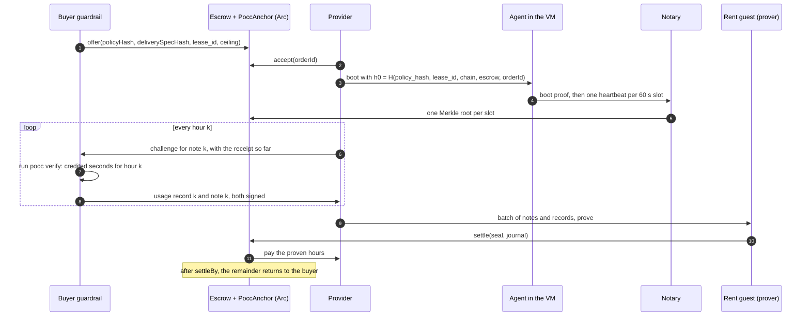

# Use case: compute rent with a delivery proof

Status: 2026-10-29, proposal. Companion to
[`hardware-purchase/spec.md`](../hardware-purchase/spec.md). It answers open point 1
of that specification for hosted services: who confirms delivery.

Abbreviations: PoCC — Proof of Cloud Compute; VM — virtual machine; TEE — trusted
execution environment; zkVM — zero-knowledge virtual machine.

## 1. The case in one paragraph

A buyer's agent rents a VM by the hour from a cloud provider. The buyer's funds sit in
the escrow from the moment the order is placed. The provider is paid only for hours
that it proved it delivered. The proof does not come from the provider's meter. It
comes from an agent inside the VM, a public randomness beacon, and anchors on the
escrow chain. A policy that the buyer approved in advance names the proof and the
price. No human touches a normal hour. The buyer's rule decides what an hour with
downtime is worth.

## 2. Why a delivery proof

The hardware-purchase specification left the question open: for a hosted service,
who signs the acceptance? A note that the buyer signs authorizes a payment. It does not
prove that the service ran. The provider's own meter is the party being paid. In the
PoCC live test of 2026-10-28, the provider's meter (OpenStack Nova) billed 3,516 s for
an hour in which the VM ran for 2,460 s. The difference was build time before the VM
was ready and ten minutes in which the provider had paused it.

PoCC closes the gap. Its verifier credits only the seconds between two heartbeats
that the VM's agent signed and that a notary anchored within 30 s of their beacon
round. The verifier is public code over public inputs. Anyone who runs it on the same
receipt gets the same result. That makes the meter a computation, not a party.

## 3. Actors and what they hold

| Actor | Holds | Trust |
|---|---|---|
| Buyer's owner | Approves the policy once; funds orders | Trusted for their own money |
| Buyer guardrail | The wallet key and one guardrail key. The guardrail key signs notes and usage records and vouches for the provider | Trusted within the order's ceiling. It runs the PoCC verifier. |
| Provider | The payout key; the OpenStack cloud; the notary | Untrusted counterparty. Its evidence is signed by the agent in the VM, not by the provider. |
| Agent in the VM | A key born at boot and erased at the end | Trusted to sign what it sees. Without hardware attestation the provider can read the key; the policy states the assurance level it accepts. |
| Notary | An anchoring wallet | Nothing. It batches heartbeats and anchors roots. A dropped heartbeat earns nothing, so it cannot help the provider. |
| drand beacon | — | A public random value every 3 s. Fixes the earliest time of each heartbeat. |
| Escrow chain (Arc) | The USDC; the `PoccAnchor` contract | Fixes the latest time of each heartbeat; pays only on a proof |
| Rent guest (zkVM) | The checker program | Checks the usage records and the policy; emits the journal |

## 4. The policy

The buyer's policy is a rent policy of the framework
(`policy-execution/docs/framework.md`). Its `delivery` section is the delivery proof,
written in advance:

| Field | What it fixes |
|---|---|
| `kind: signed_usage`, `meter_key` | Only a usage record signed by the buyer's guardrail key counts as delivery |
| `meter_spec` | The hash of PoCC's parameters: VM image, flavor, beacon, slot length, bracket, anchor contract, attestation level. The verifier signs nothing for other parameters |
| `price_per_unit`, `tolerance` | A note for hour k pays at most `credited seconds × price` |
| `min_uptime_bp`, `min_assurance` | An hour below the uptime floor or the assurance level is not paid |
| `rule` | The owner's spending rules on top: amount cap, provider category, acceptance |

The policy also fixes `lease_id`, the ceiling, the per-hour cap and the batch size.
The escrow stores `policyHash` and `deliverySpecHash` at `offer`. A receipt for other
values cannot settle the order.

## 5. The hourly cycle

The buyer takes no part in settlement. It answers one challenge per hour. If the
buyer does not answer, the provider stops the service after that hour. If the provider
delivers nothing, no heartbeat exists and no hour is paid.

## 6. What is proved and what is not

| Proved | Not proved in the first implementation |
|---|---|
| The VM existed and ran the agent for every credited minute | That the VM ran the agreed image on genuine hardware: this needs attestation (Stage 1 of PoCC, AMD SEV-SNP) |
| The seconds were counted by public code that anyone can re-run | That the VM was fast or responsive while it heartbeated |
| The provider was paid at most `credited × price` per hour | That the buyer's guardrail ran the verifier honestly: it can under-credit, which costs the provider one hour and is visible to anyone who re-runs the verifier |
| Every payment names the policy and the delivery specification the buyer approved | — |

A later step runs the PoCC verifier inside the rent guest. The chain then re-runs
the meter, and the guardrail key no longer attests delivery.

## 7. Disputes

Not in the first implementation. A disagreement ends where the framework ends it:
a missing or insufficient record gives `Ask`, the owner decides, and the hour stays
unpaid until then. A dispute entity with re-execution by a referee is designed in the
PoCC integration specification and deferred.

## 8. Costs

| Item | Size |
|---|---|
| Agent in each VM | One signature and one small request per minute |
| Notary anchoring | 1,440 transactions a day for all VMs together; paid by the provider as a cost of selling |
| Verification | Seconds of CPU per hour, on the buyer's side |
| Proving | One proof per batch of hours, in the background; the batch size follows the measured proving cost |

## 9. Demo moments

1. The buyer funds an order; the provider accepts and boots the VM; heartbeats appear on the anchor contract within a minute.
2. The provider's own meter bills 3,516 s for an hour; the receipt is refused with `E_OVERBILL`.
3. The provider pauses the VM for ten minutes; the hour is credited 2,460 s; the buyer's uptime rule refuses the note; nothing is paid for that hour.
4. An honest hour: one record, one note, one batch, one settlement.

## 10. Sources

- PoCC specification and code: [`mnemonik-xyz/pocc`](https://github.com/mnemonik-xyz/pocc), in particular `docs/warrant-integration.md`, `docs/decisions.md` and `test/live/2026-10-28/README.md`.
- The rent case in policy-execution: `docs/product/lease-evidence.md` section 5a (pull request #76) and `docs/handoff/03-rent-case.md`.
